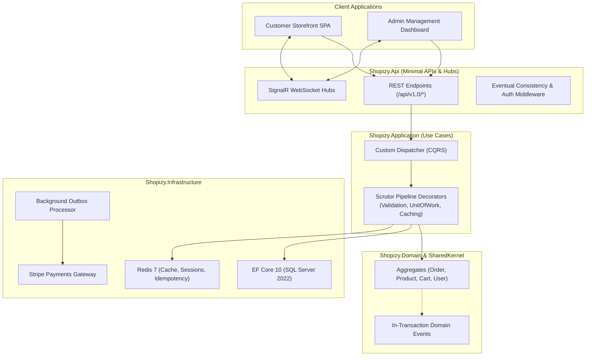

<div align="center">

# 🛍️ Shopizy API

### Scalable digital store management API built with .NET 10, Clean Architecture, and Domain-Driven Design (DDD)

[](https://github.com/akazad13/shopizy-api/actions)
[](https://codecov.io/gh/akazad13/shopizy-api)
[](https://dotnet.microsoft.com/)
[](https://learn.microsoft.com/en-us/dotnet/csharp/)
[](https://www.microsoft.com/sql-server)
[](https://redis.io/)
[](LICENSE)

[Overview](#-overview) •
[Architecture](#-architecture) •
[Tech Stack](#-tech-stack) •
[Repository Layout](#-repository-layout) •
[Quick Start](#-quick-start) •
[Testing](#-testing) •
[Documentation](#-documentation)

</div>

---

## 📌 Overview

**Shopizy API** is a robust, production-grade e-commerce backend built with .NET 10, following the principles of Clean Architecture and Domain-Driven Design (DDD). It provides an extensive Minimal API surface governing catalog management, faceted search, session-backed carts, inventory protection, Stripe payments, multi-carrier shipping, SignalR live telemetry, and customer loyalty.

### Key Highlights
- 🏛️ **Clean Architecture & Custom CQRS**: Strict layer boundaries (Domain, Application, Infrastructure, Api) driven by a lightweight custom mediator (`IDispatcher`) and Scrutor pipeline decorators.
- 🔍 **Faceted Search & Typo Tolerance**: Multi-token catalog search with Levenshtein fuzzy distance, synonym expansion, dynamic facet buckets, and "Did You Mean?" hints.
- 🛒 **Cart & Inventory Protection**: Sliding Redis carts, abandoned cart recovery workers, and atomic stock reservation preventing overselling under high concurrency.
- 💳 **Stripe Reconciliation & Idempotency**: Idempotent webhook handling, automated refunds, and standard `X-Idempotency-Key` headers on mutating requests.
- 📡 **Real-Time WebSockets**: SignalR hubs powering instant customer order tracking (`/hubs/orders`) and live merchant dashboard metrics (`/hubs/admin-dashboard`).
- 🧪 **1,164 Automated Tests**: High-density test suite covering unit tests, architecture tests (NetArchTest), and integration tests with Testcontainers.

---

## 🏛 Architecture



> [!NOTE]
> Detailed domain aggregates, outbox guarantees, and event dispatching workflows are fully documented in [docs/TechnicalDocumentation.md](docs/TechnicalDocumentation.md).

---

## 🛠 Tech Stack

| Domain | Technologies |
| :--- | :--- |
| **Framework & Language** | .NET 10, ASP.NET Core Minimal APIs, C# 14 |
| **Architecture Patterns** | Clean Architecture, DDD, CQRS, Transactional Outbox, Decorator Pattern |
| **Persistence & Database** | Entity Framework Core 10, Microsoft SQL Server 2022 |
| **Distributed Cache & State** | Redis 7 (Caching, sliding refresh tokens, idempotency keys) |
| **Dependency Injection** | Scrutor (Assembly scanning and decorator registration) |
| **Real-time WebSockets** | ASP.NET Core SignalR |
| **External Integrations** | Stripe SDK (Payments & Webhooks), Cloudinary (Media optimization) |
| **Testing** | xUnit, Shouldly, Moq, NetArchTest, Testcontainers (SQL Server) |

---

## 📂 Repository Layout

```text
├── src/
│   ├── Shopizy.Api/             # Minimal API endpoints, middleware, SignalR hubs
│   ├── Shopizy.Application/     # Commands, Queries, Handlers, FluentValidation rules
│   ├── Shopizy.Domain/          # Aggregates, Entities, Value Objects, Domain Events
│   ├── Shopizy.SharedKernel/    # Domain and application primitives (IDispatcher, ErrorOr)
│   ├── Shopizy.Infrastructure/  # EF Core, SQL Server, Redis, Outbox background workers
│   └── Shopizy.Contracts/       # Shared DTOs for HTTP request and response models
├── tests/                       # Unit, integration (Testcontainers), and architecture tests
├── docs/                        # PRD, Technical docs, Threat Model, and API references
├── Bruno/                       # API collection for local testing and debugging
└── docker-compose.yml           # Local SQL Server 2022, Redis 7, and Mailpit
```

---

## 🚀 Quick Start

### Prerequisites
- [.NET 10 SDK](https://dotnet.microsoft.com/)
- [Docker Desktop](https://www.docker.com/)

### 1. Clone & Start Dependencies
```bash
git clone https://github.com/akazad13/shopizy.git
cd shopizy
docker compose up -d
```
Starts Microsoft SQL Server 2022, Redis 7, and Mailpit.

### 2. Run Database Migrations
```bash
dotnet ef database update --project src/Shopizy.Infrastructure --startup-project src/Shopizy.Api
```

### 3. Run the API
```bash
dotnet run --project src/Shopizy.Api
```
- **Swagger UI**: `https://localhost:7172/swagger`
- **Mailpit**: `http://localhost:8025`

---

## 🧪 Testing

```bash
# Run all 1,164 automated tests
dotnet test
```

| Test Suite | Focus | Framework |
| :--- | :--- | :--- |
| **Unit Tests** | Domain invariants, business logic, handlers | xUnit + Shouldly |
| **Architecture Tests** | Layer boundaries and dependency isolation | NetArchTest |
| **Integration Tests** | Real database & endpoint execution | Testcontainers (SQL Server 2022) |

---

## 📚 Documentation

| Document | Focus |
| :--- | :--- |
| 📋 [docs/ProductRequirementsDocument.md](docs/ProductRequirementsDocument.md) | Vision, user personas, epics, and business invariants |
| 🏛️ [docs/TechnicalDocumentation.md](docs/TechnicalDocumentation.md) | Clean Architecture, DDD, CQRS, and caching strategies |
| 🔌 [docs/Api.md](docs/Api.md) | API endpoints, contracts, and versioning details |
| 🗄️ [docs/Domain.md](docs/Domain.md) | Domain aggregates, entities, and value objects |
| 🔄 [docs/EventualConsistency.md](docs/EventualConsistency.md) | In-transaction event dispatching and outbox policies |
| 🛡️ [docs/ThreatModel.md](docs/ThreatModel.md) | STRIDE security analysis and mitigations |

---

## 👤 Author

**Md. Abul Kalam**
- GitHub: [@akazad13](https://github.com/akazad13)
- LinkedIn: [Md. Abul Kalam](https://linkedin.com/in/akazad13)

---

## 📄 License

This project is licensed under the [MIT License](LICENSE).
