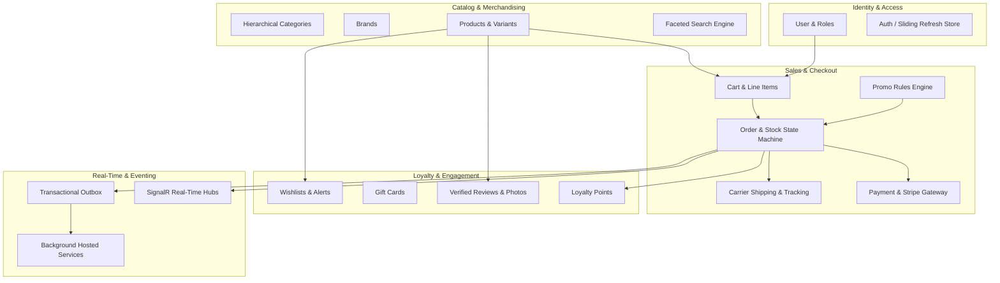
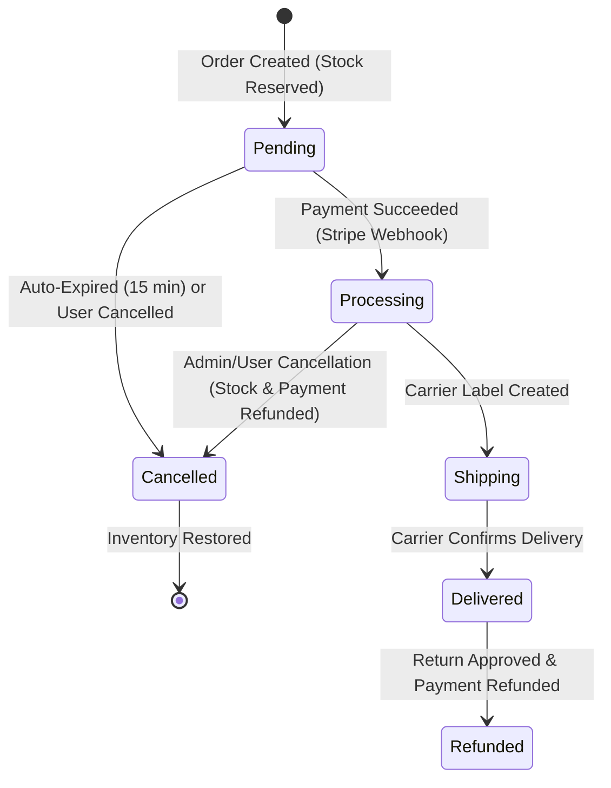
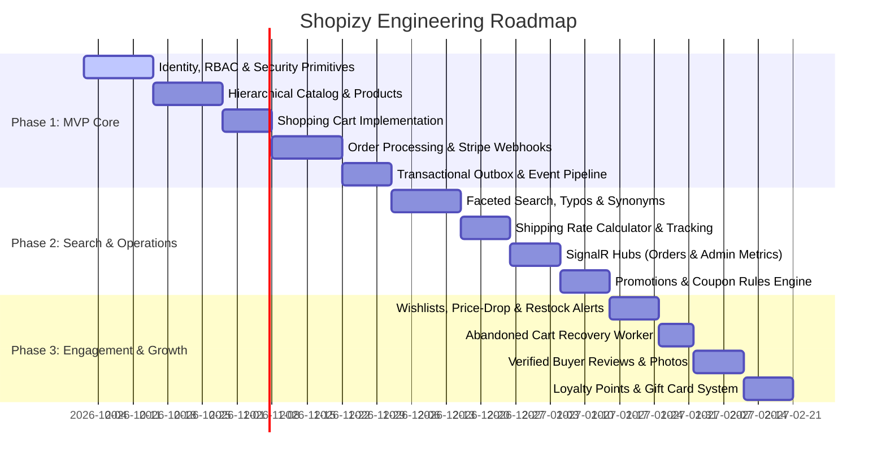

# 📋 Shopizy — Product Requirements Document (PRD)

> **Document Version:** 1.0.0  
> **Status:** Approved / Ready for Engineering  
> **Target Audience:** Engineering Leads, Software Engineers, QA, DevOps, Product Team  
> **System Name:** Shopizy (Online Store Management & E-Commerce Platform)  
> **Architecture Style:** Clean Architecture & Domain-Driven Design (DDD)  
> **Target Framework:** .NET 10 (C# 13) | ASP.NET Core Minimal APIs | SQL Server 2022 | Redis 7

---

## 📑 Table of Contents

1. [Executive Summary & Product Vision](#1-executive-summary--product-vision)
2. [Target Personas & User Classes](#2-target-personas--user-classes)
3. [Domain Architecture & Bounded Contexts](#3-domain-architecture--bounded-contexts)
4. [Functional Epics & Detailed Requirements](#4-functional-epics--detailed-requirements)
   - [Epic 1: Identity, Authentication & Role-Based Access Control (RBAC)](#epic-1-identity-authentication--role-based-access-control-rbac)
   - [Epic 2: Product Catalog & Multi-Variant Merchandising](#epic-2-product-catalog--multi-variant-merchandising)
   - [Epic 3: Search, Faceting & Discovery Engine](#epic-3-search-faceting--discovery-engine)
   - [Epic 4: Shopping Cart & Automated Abandoned Cart Recovery](#epic-4-shopping-cart--automated-abandoned-cart-recovery)
   - [Epic 5: Promotions, Discounts & Customer Loyalty](#epic-5-promotions-discounts--customer-loyalty)
   - [Epic 6: Order Lifecycle, Inventory Reservation & Auto-Expiration](#epic-6-order-lifecycle-inventory-reservation--auto-expiration)
   - [Epic 7: Payment Gateway & Webhook Reconciliation (Stripe)](#epic-7-payment-gateway--webhook-reconciliation-stripe)
   - [Epic 8: Multi-Carrier Shipping & Live Tracking](#epic-8-multi-carrier-shipping--live-tracking)
   - [Epic 9: Real-Time Operations & Admin Dashboards (WebSockets)](#epic-9-real-time-operations--admin-dashboards-websockets)
   - [Epic 10: Social Proof, Verified Reviews & Customer Engagement](#epic-10-social-proof-verified-reviews--customer-engagement)
5. [Critical Business Rules & Invariants](#5-critical-business-rules--invariants)
6. [Non-Functional Requirements (NFRs)](#6-non-functional-requirements-nfrs)
7. [Phased Implementation Roadmap](#7-phased-implementation-roadmap)
8. [Engineering Definition of Done (DoD) & Acceptance Criteria](#8-engineering-definition-of-done-dod--acceptance-criteria)

---

## 1. Executive Summary & Product Vision

### 1.1 Vision Statement
**Shopizy** is an enterprise-grade, high-throughput, headless e-commerce backend platform. It empowers modern digital retail businesses by delivering frictionless shopping experiences, zero-inventory-overselling guarantees, sub-second search and discovery, real-time operational transparency, and automated customer retention workflows.

### 1.2 Core Value Propositions
* **Frictionless Discovery:** Multi-token search with typo tolerance (Levenshtein distance), domain synonym expansion, and live "Did You Mean?" keyword recovery.
* **Guaranteed Inventory Integrity:** Atomic stock reservation during checkout paired with an automated 15-minute expiration backstop for unpaid orders.
* **Automated Retention Drivers:** Automated abandoned cart recovery email sequences, price-drop alerts, back-in-stock notifications, loyalty reward points, and digital gift cards.
* **Real-Time Operational Visibility:** WebSocket-based event streaming via SignalR for live customer order tracking and merchant sales/revenue metrics.
* **Architectural Excellence:** Built on Clean Architecture and DDD principles with a lightweight, custom CQRS messaging pipeline and transactional outbox guarantees.

---

## 2. Target Personas & User Classes

| Persona | Role & Core Needs | Typical Interactions |
|---|---|---|
| **Online Shopper (Guest & Registered)** | Wants fast product discovery, trustworthy stock counts, frictionless checkout, real-time tracking, and post-purchase engagement. | Searches catalog, filters products, manages cart and wishlist, applies promo codes, checks out via Stripe, tracks delivery status, earns loyalty points, submits verified reviews. |
| **Store Administrator / Merchant** | Needs centralized catalog management, promotional rule authoring, order fulfillment oversight, user permission management, and live sales monitoring. | Creates/updates products and variants, sets up tiered discounts and BOGO sales, oversees order status updates, manages user roles, monitors real-time revenue dashboards. |
| **Fulfillment / Support Specialist** | Needs instant visibility into order stages, live carrier scans, and controlled cancellation/refund processing. | Inspects tracking milestones, processes cancellations, initiates Stripe refunds, resolves shipping inquiries. |
| **Automated System Agents (Workers)** | Background processes ensuring business consistency, timely reminders, and data reconciliation without human intervention. | Cancels unpaid orders older than 15 minutes, dispatches abandoned cart reminders after 2 hours of inactivity, sweeps transactional outbox messages, triggers price-drop/restock alerts. |

---

## 3. Domain Architecture & Bounded Contexts

---

## 4. Functional Epics & Detailed Requirements

### Epic 1: Identity, Authentication & Role-Based Access Control (RBAC)
**Goal:** Deliver enterprise identity verification, secure session management, and granular permission enforcement.

* **Account Registration & Password Security:**
  * Support email and password registration.
  * Enforce high-entropy password standards: minimum 12 characters, requiring uppercase, lowercase, numbers, special characters, and screening against known compromised password dictionaries.
  * Passwords hashed using PBKDF2 with HMAC-SHA512.
* **Token Lifecycle & Session Security:**
  * Short-lived JWT access tokens containing user claims (`sub`, `email`, `role`, `permission`).
  * Opaque sliding refresh tokens stored in Redis with sliding expiration and per-user revocation indexes.
  * Single-session revocation and absolute logout support.
* **Role-Based Access Control (RBAC):**
  * System roles: `Customer` and `Admin`.
  * Granular permission checks mapped via cached lookup service.
  * Resource ownership checks (`AuthorizeOwner`): Customer routes strictly enforce that the caller's JWT `sub` matches the route `userId`, preventing horizontal privilege escalation.
* **Admin User Administration:**
  * Paginated customer lists with search and filtering.
  * Endpoint to modify user roles and update assigned permission sets.

---

### Epic 2: Product Catalog & Multi-Variant Merchandising
**Goal:** Provide merchants with flexible tools to organize, present, and update a rich product catalog.

* **Hierarchical Category Tree:**
  * Self-referencing recursive parent-child taxonomy supporting unlimited nesting depth.
  * Dynamic category path resolution for breadcrumbs and navigation.
* **Brand Management:**
  * Brand entity holding name, logo URL, and description for brand-based filtering.
* **Product Variations & Dimensionality:**
  * Base product metadata: Title, description, SKU, barcode, tags, rating stats.
  * Multi-variant matrix supporting dimension pairs (e.g., Color and Size combinations).
  * Multi-currency unit pricing (`USD`, `EUR`, `GBP`, etc.).
* **Media Asset Management:**
  * Image galleries with sequence ordering and primary thumbnail selection.
  * Integration with Cloudinary for image optimization and CDN distribution.
* **Write Collision Protection:**
  * Optimistic concurrency tokens (`RowVersion`) on product records to prevent simultaneous conflicting updates from overwriting inventory or pricing.

---

### Epic 3: Search, Faceting & Discovery Engine
**Goal:** Empower customers to find desired products instantly, even with partial or misspelled terms.

* **Relevance & Text Scoring:**
  * Multi-token text matching across product title, tags, description, category, and brand.
* **Fuzzy Search & Typo Tolerance:**
  * Levenshtein distance evaluation ensuring misspelled search inputs (e.g., `"iphne"`, `"runing shoe"`) successfully surface intended products.
* **Retail Synonym Expansion:**
  * Automatic synonym normalization (e.g., querying `"sneakers"` retrieves products labeled `"athletic shoes"` or `"running shoes"`).
* **"Did You Mean?" Suggestions:**
  * Predictive keyword recommendations generated when exact match counts fall below a threshold.
* **Multi-Dimensional Facet Buckets:**
  * Category and Brand distribution counts.
  * Dynamic price range buckets (`<$25`, `$25–$50`, `$50–$100`, `$100–$200`, `$200+`).
  * Rating tiers (`4★ & above`, `3★ & above`, `2★ & above`, `1★ & above`).
  * Real-time stock status counts (`In-Stock` vs `Out-of-Stock`).

---

### Epic 4: Shopping Cart & Automated Abandoned Cart Recovery
**Goal:** Maximize checkout conversion and re-engage dropped customer sessions automatically.

* **High-Throughput Cart Management:**
  * Line items with selected variant options (color, size, quantity).
  * Price snapshots at the moment of addition to detect subsequent price alterations.
* **Cart Inactivity Tracking:**
  * Audit timestamps (`LastModifiedOn`, `LastAbandonedReminderSentOn`) on cart entities.
* **Automated Abandoned Cart Worker:**
  * Background hosted service running periodically.
  * Identifies carts modified $\ge 2\text{ hours}$ ago with no completed checkout.
  * Triggers personalized recovery email containing cart summary and a direct checkout link.
  * Built-in cooldown logic prevents duplicate spamming of the same cart session.

---

### Epic 5: Promotions, Discounts & Customer Loyalty
**Goal:** Drive Average Order Value (AOV) and customer retention through versatile discount rules and incentives.

* **Promotions & Coupon Engine (`PromoCode`):**
  * **Discount Formats:** Flat fixed-amount discount or percentage discount.
  * **Spend Thresholds:** Minimum cart subtotal qualifying rules (`MinimumOrderAmount`).
  * **BOGO Campaigns:** "Buy X, Get Y Free/Discounted" logic with automatic discount calculation on qualifying units.
  * **Category Constraints:** Coupon validity restricted to specific category IDs.
  * **Risk Safety Caps:** Hard ceiling on maximum allowable discount (`MaxDiscountAmount`), global usage limits, and strict start/end date validity windows.
* **Customer Loyalty Points:**
  * Points earned proportionally on completed orders.
  * Redeemable during checkout as a direct balance offset.
  * Append-only ledger tracking all transaction points (`Earn`, `Redeem`, `Expire`).
* **Digital Gift Cards:**
  * Alphanumeric redemption codes with initial and remaining balance tracking.
  * Partial balance redemption during checkout.

---

### Epic 6: Order Lifecycle, Inventory Reservation & Auto-Expiration
**Goal:** Deliver 100% stock accuracy, prevent overselling, and automate fulfillment progression.

* **Atomic Stock Reservation:**
  * Available stock is deducted atomically at the moment an order is created.
  * If requested quantity exceeds available stock, the order creation command is rejected immediately with an informative error.
* **Idempotent Order Creation:**
  * Mandatory `X-Idempotency-Key` header on checkout submissions stored in Redis (24-hour TTL) prevents duplicate submissions and double orders.
* **15-Minute Unpaid Order Auto-Expiration:**
  * Background worker (`PendingOrderExpirationWorker`) executes every 60 seconds.
  * Identifies orders remaining in `Pending` state for $> 15\text{ minutes}$.
  * Automatically marks them `Cancelled` and releases reserved stock back to the active catalog.
* **Stock Restoration Guarantee:**
  * Whenever an order transitions to `Cancelled` or `Refunded`, line item quantities are automatically replenished.

---

### Epic 7: Payment Gateway & Webhook Reconciliation (Stripe)
**Goal:** Provide secure, PCI-compliant payment flows with idempotent state reconciliation.

* **Stripe Payment Intent Integration:**
  * Server-side creation of payment intents, returning client secret to the checkout client.
* **Resilient Webhook Receiver (`POST /api/v1.0/webhooks/stripe`):**
  * Cryptographic signature verification using Stripe webhook secrets.
  * Event handlers:
    * `payment_intent.succeeded` $\to$ Moves order to `Processing`, triggers confirmation email, broadcasts SignalR notification.
    * `payment_intent.payment_failed` $\to$ Moves order to `Cancelled`, restores product stock.
    * `charge.refunded` $\to$ Transitions order to `Refunded`.
* **Automated Post-Payment Refunds:**
  * Programmatic Stripe refund trigger when an already-paid order is cancelled by merchant or customer.

---

### Epic 8: Multi-Carrier Shipping & Live Tracking
**Goal:** Provide transparent delivery pricing and live parcel movement updates.

* **Multi-Carrier Rate Estimation:**
  * Dynamically queries rates across **USPS**, **UPS**, **FedEx**, and **DHL**.
  * Calculates shipping costs based on total weight, dimensions, destination zone, and delivery speeds (Ground, 2-Day Express, Overnight).
* **Automated Free Shipping Rules:**
  * Configurable basket subtotal qualifying threshold (e.g., free standard ground shipping on orders $\ge \$100$).
* **Live Package Tracking:**
  * Multi-stage milestone scans: *Origin Hub $\to$ Sorting Center $\to$ In Transit $\to$ Out for Delivery $\to$ Delivered*.
  * Provides estimated delivery arrival dates and current location details.

---

### Epic 9: Real-Time Operations & Admin Dashboards (WebSockets)
**Goal:** Eliminate HTTP polling and provide instantaneous data synchronization across customer and admin clients.

* **Customer Order Hub (`/hubs/orders`):**
  * Authenticated customers automatically join dedicated user channels (`user-{userId}`).
  * Broadcasts live `ReceiveOrderStatusUpdate` payloads as orders transition through states.
* **Admin Real-Time Dashboard Hub (`/hubs/admin-dashboard`):**
  * Secured exclusively for users with the `Admin` role.
  * Streams real-time operational metrics: incoming orders, order cancellations, and rolling revenue totals.
* **Unified Notification Dispatcher:**
  * Sends transactional HTML emails for order confirmation, shipment dispatch, password resets, price drops, and restocks.
  * Respects user-configured notification preferences.

---

### Epic 10: Social Proof, Verified Reviews & Customer Engagement
**Goal:** Build shopper trust and drive repeat visits through authentic community feedback and proactive alerts.

* **Verified Buyer Reviews:**
  * 1-to-5 star rating system with title, review body, and photo attachments.
  * System automatically verifies whether the user has a completed, delivered purchase of the product before stamping the `IsVerifiedPurchase` badge.
  * Product aggregate score and rating distribution recalculated upon each approved review.
* **Community Helpfulness Upvoting:**
  * Shoppers can upvote insightful reviews (`HelpfulVotesCount`).
* **Customer Wishlists & Proactive Alerts:**
  * Shoppers save items to personal wishlists.
  * **Price-Drop Trigger:** When product price is discounted, a domain event notifies all wishlist subscribers holding that product.
  * **Back-in-Stock Trigger:** When an out-of-stock product receives inventory replenishment, a domain event alerts interested wishlist holders.

---

## 5. Critical Business Rules & Invariants

> [!IMPORTANT]
> **Cardinal Non-Negotiables for Engineering:**
> 1. **Zero Overselling:** Stock must be deducted atomically during the initial order creation transaction. If stock is insufficient, the checkout command **must fail**.
> 2. **Unpaid Stock Release:** Unpaid orders lingering in `Pending` state for $> 15\text{ minutes}$ **must be cancelled** by the expiration worker, and stock must be immediately returned to catalog inventory.
> 3. **Tenant & Owner Isolation:** Users must never read or modify another user's cart, order, wishlist, or personal data. Route ownership verification (`AuthorizeOwner`) is mandatory across all user-scoped endpoints.
> 4. **Review Verification Integrity:** The `IsVerifiedPurchase` flag cannot be manually toggled; it must be verified programmatically against the historical order database.
> 5. **Idempotent Webhooks & Payments:** Double webhook deliveries from Stripe or duplicate checkout clicks must never trigger duplicate state transitions or duplicate charges.

---

## 6. Non-Functional Requirements (NFRs)

### 6.1 Performance & Scalability
* **API Response Times:** 95% of cached read requests must complete in $\le 50\text{ms}$; complex faceted search queries must complete in $\le 200\text{ms}$.
* **Real-Time Push Latency:** SignalR WebSocket messages must dispatch within $\le 500\text{ms}$ of database commit.
* **Concurrency:** Database mutations must employ optimistic concurrency tokens (`RowVersion`) to detect and handle simultaneous conflicts cleanly (HTTP 409 Conflict).

### 6.2 Data Integrity & Consistency
* **Transactional Outbox Pattern:** Domain events must be persisted within the same database transaction as the aggregate state change to prevent lost events or ghost triggers.
* **Resilient Event Dispatching:** Background sweepers must pick up any unprocessed outbox events older than 5 minutes and route dead letters after exhausting retries.

### 6.3 Security & Privacy
* **PII & Data Sanitization:** Zero sensitive credentials, tokens, or payment details in system logs; high-performance compile-time logging delegates with regex masking must sanitize output.
* **Rate Limiting:** Auth endpoints throttled to 5 requests/minute per IP; general endpoints throttled to 100 requests/minute per user.
* **Security Headers:** Strict injection of HSTS, CSP, X-Frame-Options, X-Content-Type-Options, COOP, and CORP headers across all HTTP responses.

---

## 7. Phased Implementation Roadmap

### Phase 1: MVP Core (Fulfillment & Checkout Foundation)
* User registration, JWT + Redis refresh token store, RBAC structure.
* Category tree, Brand management, Product catalog with variants and Cloudinary imagery.
* Cart CRUD with price snapshotting.
* Order placement with atomic stock deduction and 15-minute auto-expiration worker.
* Stripe Checkout & Webhook handler with signature verification.
* Transactional Outbox pattern implemented in `AppDbContext`.

### Phase 2: Search, Merchandising & Operations
* Multi-token search with typo tolerance and dynamic faceting.
* Promotions engine supporting BOGO, percentage, fixed, and minimum spend rules.
* Multi-carrier shipping rate estimation and live shipment tracking checkpoints.
* SignalR WebSockets for customer order notifications and admin metrics.

### Phase 3: Growth, Retention & Social Proof
* Customer wishlists with price-drop and back-in-stock notifications.
* Automated abandoned cart recovery worker (2-hour inactivity sweep).
* Verified buyer product reviews with photo uploads and helpful votes.
* Loyalty points accrual/redemption and digital gift card vouchers.

---

## 8. Engineering Definition of Done (DoD) & Acceptance Criteria

Before any epic or feature is accepted into production, the following engineering criteria must be satisfied:

1. **Architecture & Boundaries:**
   * Strict adherence to Clean Architecture: `Domain` has zero external dependencies; `Application` exposes CQRS handlers; `Infrastructure` implements I/O; `Api` handles transport.
   * Business operations wrapped in custom MediatR-free messaging (`ICommand<T>`, `IQuery<T>`).
   * Cross-cutting concerns handled via Scrutor decorators (Validation, Caching, Unit of Work).
2. **Automated Testing Suite:**
   * **Domain Unit Tests:** 100% coverage on Domain aggregates, state transitions, and business invariants.
   * **Integration Tests:** Critical customer flows (Checkout, Webhooks, Search) tested against containerized databases using Testcontainers.
   * **Architecture Tests:** NetArchTest rules passing to enforce clean layer boundaries and prevent circular dependencies.
3. **Observability & Diagnostics:**
   * Compile-time `LoggerMessage` delegates with PII sanitization enabled.
   * OpenTelemetry traces on outbound HTTP calls, database queries, and background workers.
4. **API Contracts:**
   * All endpoints documented via OpenAPI/Swagger specifications with strongly-typed contract models located in `Shopizy.Contracts`.
